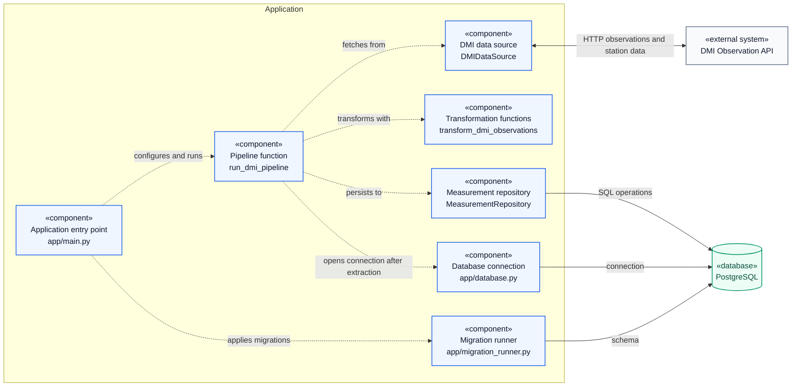
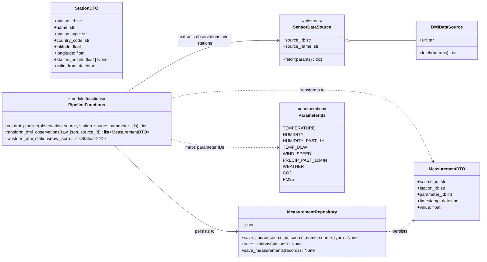
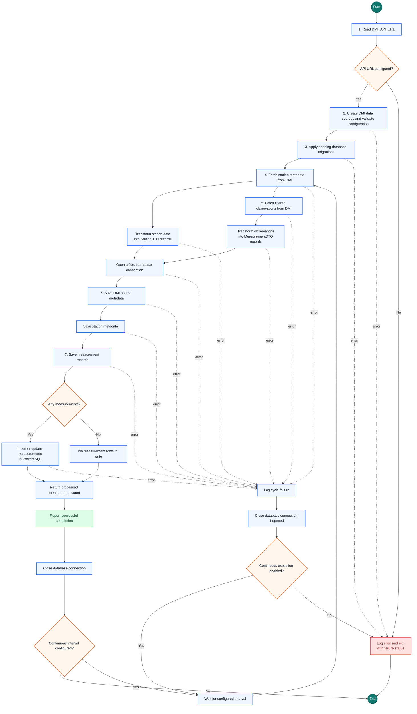
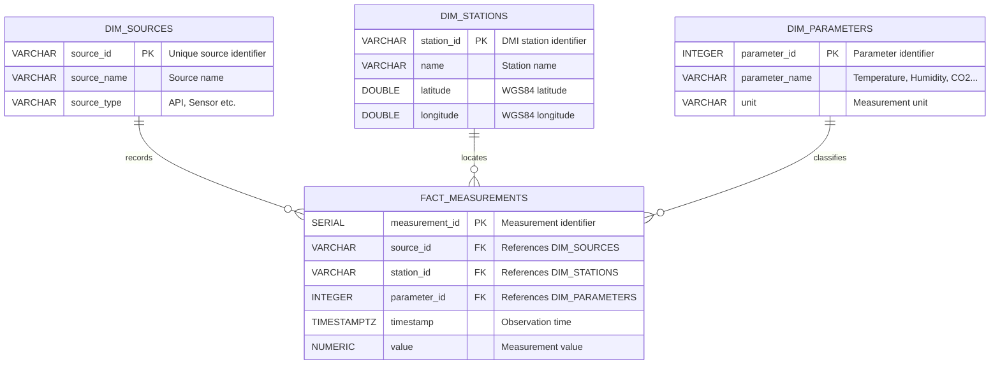

# Environment Data Project

A Python ETL application that retrieves environmental observations from the
Danish Meteorological Institute (DMI), transforms supported measurements, and
stores them in PostgreSQL.

The project is organized into extraction, transformation, and persistence
components, with versioned database migrations and automated unit and
integration tests.

---

## Contents

- [Features](#features)
- [Technology stack](#technology-stack)
- [Getting started](#getting-started)
- [Project structure](#project-structure)
- [File overview](#file-overview)
- [Architecture](#architecture)
- [Learning objectives](#learning-objectives)
- [Author](#author)

---

## Features

- Retrieve environmental observations from the DMI API
- Filter observations by parameter and a rolling time window at the API
- Fetch parameter-filtered observations concurrently, with a five-request
  limit to avoid unbounded load on DMI
- Transform the documented DMI meteorological observation parameters,
  including categorical weather and snow-cover codes
- Store source metadata, station locations, and measurements in PostgreSQL
- Apply versioned SQL migrations automatically at startup
- Optionally repeat the DMI pipeline at a configurable interval
- Run unit and integration tests with Pytest
- Use Docker Compose for local development and execution
- Manage the database through pgAdmin

---

## Technology stack

- **Python 3**
- **PostgreSQL**
- **Docker & Docker Compose**
- **Psycopg**
- **Requests**
- **Pytest**
- **pgAdmin**

---

## Getting started

### Prerequisites

- Git
- Docker Desktop with Docker Compose

### Clone the repository

```bash
git clone https://github.com/mielouise/environment_data_project.git
cd environment_data_project
```

### Configure environment variables

Create a local `.env` file from the committed example before starting the
project:

```powershell
Copy-Item .env.example .env
```

Review `.env` and replace the example passwords before using the project
outside local development. `.env` is ignored by Git; do not commit real
credentials.

| Variable | Required | Description |
|----------|----------|-------------|
| `DMI_API_URL` | Yes | DMI collections URL, for example `https://opendataapi.dmi.dk/v2/metObs/collections`. The application appends the selected collection and `/items` path. For a local API, set its reachable collections URL here. |
| `POSTGRES_HOST` | Yes | Database host; use `db` when running with Docker Compose. |
| `POSTGRES_PORT` | Yes | PostgreSQL port, normally `5432`. |
| `POSTGRES_DB` | Yes | PostgreSQL database name. |
| `POSTGRES_USER` | Yes | PostgreSQL username. |
| `POSTGRES_PASSWORD` | Yes | PostgreSQL password. |
| `PGADMIN_USER_EMAIL` | For pgAdmin | Email address used to sign in to pgAdmin. |
| `PGADMIN_PASSWORD` | For pgAdmin | pgAdmin sign-in password. |
| `DMI_PARAMETER_IDS` | No | Comma-separated DMI parameter IDs. Leave blank to use the selective default: `temp_dry,humidity,wind_speed,precip_past1h`. |
| `ETL_INTERVAL_SECONDS` | No | Repeat interval in seconds. Docker Compose defaults to 300 seconds; set blank for one-shot execution. |

The application builds the observation and station item endpoints from
`DMI_API_URL` in code. Use the collections URL shown above; the application
appends `/observation/items` and `/station/items` as needed.

### Start the application

```bash
docker compose up --build app
```

This builds and starts the application together with its PostgreSQL
dependency. The application initializes the database schema and runs the ETL
workflow: it requests observations from the DMI API, transforms them, and
saves the source, station locations, and measurements to PostgreSQL. By
default, it requests only air temperature (`temp_dry`), humidity (`humidity`),
wind speed (`wind_speed`), and precipitation over the previous hour
(`precip_past1h`) for Denmark, limited to the previous 24 hours. These
parameter filters are sent directly to DMI, avoiding requests for unrelated
observation types. The pipeline also supports all documented parameter
identifiers, including categorical observations; the DMI observation catalogue
does not include the legacy CO2 and PM2.5 database parameters. By default,
this is a one-shot run.

Set `DMI_PARAMETER_IDS` to any comma-separated subset of documented parameter
identifiers to change the selection and reduce API traffic further:

```bash
docker compose run --rm -e DMI_PARAMETER_IDS=temp_dry,humidity app
```

The application reads `DMI_API_URL` as the DMI collections URL and constructs
both the observation `items` endpoint and station `items` endpoint in code.
Station coordinates are taken from the GeoJSON response and measurements
retain their DMI station ID. The observation and station collections are
listed in the [DMI API collections
catalogue](https://opendataapi.dmi.dk/v2/metObs/collections); available
parameters and units are documented in the [DMI meteorological observations
catalogue](https://www.dmi.dk/friedata/dokumentation/meteorological-observations-data#c24107).

Docker Compose runs the pipeline immediately and repeats every 300 seconds by
default, including when `ETL_INTERVAL_SECONDS` is unset or blank. Change the
variable in `.env` to use another interval. To run a single cycle instead, use:

```bash
docker compose run --rm -e ETL_INTERVAL_SECONDS= app
```

The pipeline runs immediately and then repeats every 300 seconds. Each
completed cycle reports its measurement count in the app logs. A failed cycle
is logged and retried at the next interval. You can also pass
`--interval-seconds 300` when running `python -m app.main` directly.

### Run ETL on a schedule with GitHub Actions

The `.github/workflows/dmi-etl.yml` workflow runs one ETL cycle every five
minutes and can also be started manually from the repository's Actions tab.
Each scheduled run uses a fresh GitHub-hosted runner, so it connects to the
existing PostgreSQL database; it does not start the local Compose database.

Configure these repository Actions secrets before enabling the workflow:

| Secret | Description |
|--------|-------------|
| `POSTGRES_HOST` | Hostname of the existing PostgreSQL server. This must be the hosted database's reachable hostname, not `db` (which only resolves inside Docker Compose). |
| `POSTGRES_PORT` | PostgreSQL port; optional, defaults to `5432`. |
| `POSTGRES_DB` | Database name. |
| `POSTGRES_USER` | Database user. |
| `POSTGRES_PASSWORD` | Database password. |

The database must accept connections from the runner. Avoid exposing
PostgreSQL broadly to the internet; use a network-restricted hosted runner or
a self-hosted GitHub Actions runner inside the database's trusted network
when the database firewall cannot securely allow hosted runners. The
workflow runs a single cycle per invocation, applies any pending migrations,
and exits. Scheduled runs are serialized to avoid overlapping ETL jobs.
Use GitHub repository Actions secrets for all database credentials; do not
put passwords in the workflow file or commit them to the repository.

To start PostgreSQL and pgAdmin for database inspection:

```bash
docker compose up -d db pgadmin
```

Open pgAdmin at:

```text
http://localhost:8080
```

Sign in with the pgAdmin credentials configured in `.env`.

When finished, stop and remove the containers with:

```bash
docker compose down
```

The PostgreSQL data volume is retained when the containers are stopped this
way.

### Testing

Run the complete test suite, including the unit tests and integration tests:

```bash
docker compose run --build --rm tests
```

The test service waits for PostgreSQL to become healthy. Integration tests
connect to the configured PostgreSQL database and make a real request to the
DMI API, so the corresponding environment variables must be configured and
the environment must have network access to DMI.

---

## Project structure

```text
environment_data_project/
├── .devcontainer/
│   ├── Dockerfile
│   ├── devcontainer-lock.json
│   └── devcontainer.json
├── app/
│   ├── __init__.py
│   ├── constants/
│   │   ├── __init__.py
│   │   └── parameters.py
│   ├── extract/
│   │   ├── __init__.py
│   │   ├── base.py
│   │   └── dmi.py
│   ├── load/
│   │   ├── __init__.py
│   │   └── measurement_repository.py
│   ├── transform/
│   │   ├── __init__.py
│   │   ├── dmi.py
│   │   ├── models.py
│   │   └── stations.py
│   ├── database.py
│   ├── migration_runner.py
│   ├── migrations/
│   │   ├── 0001_initial_schema.sql
│   │   ├── 0002_station_locations.sql
│   │   └── 0003_dmi_observation_parameters.sql
│   ├── main.py
│   └── pipeline.py
├── pgadmin/
│   └── servers.json
├── tests/
│   ├── __init__.py
│   ├── integration/
│   │   ├── __init__.py
│   │   ├── test_dmi_api.py
│   │   └── test_postgres.py
│   └── unit/
│       ├── __init__.py
│       ├── test_database.py
│       ├── test_extract.py
│       ├── test_load.py
│       ├── test_migrations.py
│       ├── test_main.py
│       ├── test_pipeline.py
│       ├── test_stations.py
│       └── test_transform.py
├── .dockerignore
├── .gitignore
├── .env.example
├── Dockerfile
├── docker-compose.yml
├── requirements-dev.txt
├── requirements.txt
└── README.md
```

## File overview

- The `app` directory contains the application code. Docker starts the
  application through `app/main.py`, which configures and runs the pipeline.
- The `app/extract` directory contains the code for retrieving data from the
  DMI API, including a shared abstraction for data sources.
- The `app/transform` directory contains pure transformation functions and
  the measurement data model.
- The `app/load` directory contains persistence components.
- The `app/constants` directory contains shared constants, including IDs for
  the supported measurement parameters.
- The `app/migrations` directory contains versioned SQL scripts for creating
  and updating the database schema.
- `app/pipeline.py` defines the concrete DMI extract-transform-load flow.
- `app/database.py` manages database connections, while
  `app/migration_runner.py` discovers and applies SQL migrations.
- The `tests` directory contains the test suite, which is run by the `tests`
  service in Docker Compose. It is divided into two subdirectories:
  - The `tests/unit` directory contains unit tests that test application code
    in isolation from external systems, for example by using mocks.
  - The `tests/integration` directory contains integration tests that verify
    connections to external systems. `test_postgres.py` tests the connection
    to PostgreSQL, and `test_dmi_api.py` sends a request to the configured DMI
    API.
- `Dockerfile` defines the Docker image for the application and tests.
  `docker-compose.yml` configures the app, test, PostgreSQL, and pgAdmin
  services.
- `.gitignore` specifies which files Git should ignore, such as local
  environment settings. `.dockerignore` specifies which files to exclude from
  the Docker build context.
- `requirements.txt` lists the Python packages required by the application.
  `requirements-dev.txt` includes these packages along with additional
  packages needed for development and testing.
- The `.devcontainer` directory contains the development container
  configuration, and the `pgadmin` directory contains the pgAdmin
  configuration.
- `README.md` contains the project description, setup instructions, and
  database schema documentation.

---

## Architecture

The diagrams below describe the solution from four different
perspectives:

1. Application component architecture
2. Implementation design
3. Runtime ETL workflow
4. Database design

Together these views document the system at component, implementation,
execution, and database levels.

### Application component overview

- Shows the main application components and their responsibilities.
- Shows how the application communicates with the DMI API and PostgreSQL.



### Implementation relationships

- Shows the source and repository classes alongside the ETL functions.
- The solid inheritance arrow shows that `DMIDataSource` extends
  `SensorDataSource`.
- The dashed dependencies show how the pipeline connects extraction,
  transformation, and persistence.



### ETL workflow

The activity diagram below shows the application run, including database
migrations before the ETL path, optional repeated execution, transactional
writes, error handling, and connection cleanup.



The workflow proceeds as follows:

1. Apply pending database migrations to create or update the database schema.
2. Read the `DMI_API_URL` collections URL and build the observation and station
   item endpoints.
3. Create data sources for DMI observations and station metadata.
4. Fetch stations and filtered observations, then transform them into station
   and measurement records before opening a database connection.
5. Save source metadata, station metadata, and measurements in one database
   transaction. A failed load rolls back all of its writes and closes the
   connection.
6. Report the number of processed measurements and close the database
   connection. If continuous execution is enabled, wait for the configured
   interval and repeat from step 4 with a fresh connection.
7. If setup fails, report the error and exit. In continuous mode, a failed
   cycle is logged and retried after the configured interval.

#### Database migrations

The application applies pending SQL migrations automatically before starting
the ETL workflow. Migration scripts live in `app/migrations/` and are named
with a unique, increasing version and a descriptive name, for example
`0001_initial_schema.sql`. Applied versions and SHA-256 checksums are stored
in the PostgreSQL `schema_migrations` table. Migrations run in a transaction,
and a database advisory lock prevents concurrent application instances from
applying the same migration simultaneously.

The initial migration creates the original schema using idempotent
statements, so an existing database created by an earlier version of this
project can adopt migration tracking without dropping its tables or
measurement data. Later migrations add station metadata and the complete DMI
parameter catalogue.

After a migration has been committed, do not edit or rename it. To change the
schema, add a new migration file with the next version, such as
`0004_add_station_history.sql`. This preserves a consistent upgrade path for
existing installations.

### Database design

The database follows a normalized dimensional design consisting of one
fact table and three dimension tables.

This design was chosen to reduce data redundancy, improve data integrity,
and make it easier to extend the solution with additional environmental
measurement types in the future.

#### Dimension tables

##### DIM_SOURCES

Stores metadata describing each measurement source.

Examples:

- DMI Observation API
- Future environmental APIs
- Sensor networks

##### DIM_PARAMETERS

Stores metadata describing measurable environmental parameters and
their associated units.

Examples:

| ID | Parameter | Unit |
|----|-----------|------|
| 1 | Temperature | °C |
| 2 | Humidity | % |
| 3 | Humidity Past 1 Hour | % |
| 4 | CO2 | ppm |
| 5 | PM2.5 | μg/m³ |

Migration `0003_dmi_observation_parameters.sql` adds all DMI parameters in
the meteorological observations catalogue. Numeric enum codes (for example
weather codes) are stored in the same numeric value column as measurements
and use the `enum` unit to distinguish them from physical quantities.

#### Fact table

##### FACT_MEASUREMENTS

Stores individual environmental observations.

Each measurement references:

- one source
- one station
- one parameter

through foreign-key relationships.

The schema also includes a unique constraint on:

```sql
(source_id, station_id, parameter_id, timestamp)
```

#### Entity relationship diagram

The ER diagram describes the PostgreSQL data model and the relationships
between its tables.



- `DIM_SOURCES` stores metadata about each data source, including its name and
  type.
- `DIM_PARAMETERS` defines the measured parameters and their units.
- `DIM_STATIONS` stores the station identity and its latest known location.
- `FACT_MEASUREMENTS` stores each environmental observation's timestamp and
  numeric value.
- Each measurement references exactly one source, station, and parameter
  through foreign keys.
- A source, station, and parameter can each be referenced by multiple
  measurements.
- Separating measurements from descriptive metadata supports consistent
  storage and analysis across sources and parameters.

---

## Learning objectives

After completing this project, participants should be able to:

- **Apply ETL principles:** separate extraction, transformation, and loading
  responsibilities.
- **Integrate external APIs:** process API responses and handle missing,
  unexpected, or erroneous data.
- **Design comparable data models:** structure measurements from multiple
  sources and justify the schema.
- **Use PostgreSQL:** configure a database and write data from application code.
- **Build reliable pipelines:** support repeated runs without duplicate or
  destructive writes.
- **Test integrations effectively:** isolate external services in unit tests
  and target at least 95% test coverage.
- **Plan for data reuse:** consider how collection choices support future
  analysis, including workplace environmental quality.
- **Deliver professionally:** maintain the remote repository and document
  setup, build, testing, execution, architecture, and UML in the README.

---

## Author

**Mie Louise Nielsen**

GitHub: https://github.com/mielouise
