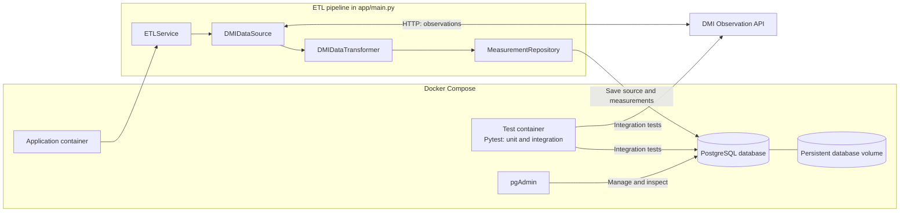
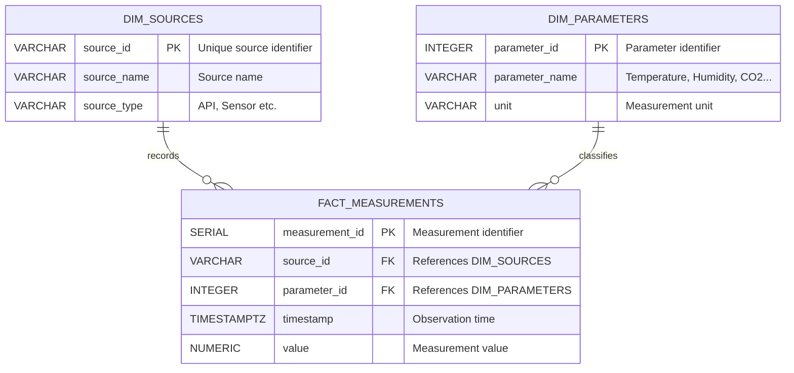

# Environment Data Project

A Python-based ETL (Extract, Transform, Load) application that collects weather and environmental data from the Danish Meteorological Institute (DMI) API, processes the data, and stores it in a PostgreSQL database.

This project demonstrates database integration, API consumption, containerized development, automated testing, and object-oriented programming principles.

---

## Features

- Extract weather and environmental data from the DMI API
- Transform raw API responses into a structured format
- Load processed data into PostgreSQL
- Containerized development environment using Docker Compose
- Database management through pgAdmin
- Automated testing with Pytest
- Clean, maintainable, and object-oriented Python code
- Type hints, docstrings, and PEP 8 compliant codebase

---

## Technology Stack

- **Python 3**
- **PostgreSQL**
- **Docker & Docker Compose**
- **Psycopg**
- **Requests**
- **Pytest**
- **pgAdmin**

---

## Architecture

The application runs as a Docker Compose service and processes environmental
observations through an extract, transform, and load (ETL) pipeline. The
PostgreSQL database stores source metadata and measurements. pgAdmin provides a
web interface for database administration, while the test service runs unit
and integration tests.



The following UML class diagram shows the main software components and their
dependencies. The stereotypes identify each component's role in the
architecture.

```mermaid
classDiagram
    direction LR

    class Main <<entry point>>
    class ETLService <<orchestrator>>
    class SensorDataSource <<interface>>
    class DMIDataSource <<component>>
    class DMI_API <<external system>>
    class DMIDataTransformer <<component>>
    class MeasurementDTO <<data object>>
    class MeasurementRepository <<component>>
    class PostgreSQL <<external database>>

    Main ..> ETLService : creates and runs
    ETLService --> SensorDataSource : fetches data from
    DMIDataSource ..|> SensorDataSource : implements
    DMIDataSource --> DMI_API : HTTP request
    ETLService --> DMIDataTransformer : transforms response
    DMIDataTransformer ..> MeasurementDTO : creates
    ETLService --> MeasurementRepository : persists results
    MeasurementRepository --> PostgreSQL : executes SQL
```

---

## Project Structure

```text
environment_data_project/
├── .devcontainer/
│   ├── Dockerfile
│   ├── devcontainer-lock.json
│   └── devcontainer.json
├── app/
│   ├── __init__.py
│   ├── constants/
│   │   ├── __init__.py
│   │   └── parameters.py
│   ├── extract/
│   │   ├── __init__.py
│   │   ├── base.py
│   │   └── dmi.py
│   ├── database.py
│   ├── etl_service.py
│   ├── load.py
│   ├── main.py
│   └── transform.py
├── pgadmin/
│   └── servers.json
├── tests/
│   ├── __init__.py
│   ├── integration/
│   │   ├── __init__.py
│   │   ├── test_dmi_api.py
│   │   └── test_postgres.py
│   └── unit/
│       ├── __init__.py
│       ├── test_database.py
│       ├── test_etl_service.py
│       ├── test_extract.py
│       ├── test_load.py
│       ├── test_main.py
│       └── test_transform.py
├── .dockerignore
├── .gitignore
├── Dockerfile
├── docker-compose.yml
├── requirements-dev.txt
├── requirements.txt
└── README.md
```

## File overview

- The `app` directory contains the application code. Docker starts the
  application through `app/main.py`, which orchestrates the ETL process. This
  file is therefore the recommended application entry point.
- The `app/extract` directory contains the code for retrieving data from the
  DMI API, including a shared abstraction for data sources.
- The `app/constants` directory contains shared constants, including IDs for
  the supported measurement parameters.
- `app/transform.py`, `app/load.py`, `app/database.py`, and
  `app/etl_service.py` handle data transformation, data storage, database
  connections, and orchestration of the ETL process, respectively.
- The `tests` directory contains the test suite, which is run by the `tests`
  service in Docker Compose. It is divided into two subdirectories:
  - The `tests/unit` directory contains unit tests that test application code
    in isolation from external systems, for example by using mocks.
  - The `tests/integration` directory contains integration tests that verify
    connections to external systems. `test_postgres.py` tests the connection
    to PostgreSQL, and `test_dmi_api.py` sends a request to the configured DMI
    API.
- `Dockerfile` defines the Docker image for the application and tests.
  `docker-compose.yml` configures the app, test, PostgreSQL, and pgAdmin
  services.
- `.gitignore` specifies which files Git should ignore, such as local
  environment settings. `.dockerignore` specifies which files to exclude from
  the Docker build context.
- `requirements.txt` lists the Python packages required by the application.
  `requirements-dev.txt` includes these packages along with additional
  packages needed for development and testing.
- The `.devcontainer` directory contains the development container
  configuration, and the `pgadmin` directory contains the pgAdmin
  configuration.
- `README.md` contains the project description, setup instructions, and
  database schema documentation.

---

## Getting Started

### Prerequisites

- Git
- Docker Desktop with Docker Compose

### Clone the Repository

```bash
git clone https://github.com/mielouise/environment_data_project.git
cd environment_data_project
```

### Configure environment variables

Docker Compose reads configuration from a `.env` file in the project root.
Create the file locally (do not commit it) and provide values for the following
variables:

- `POSTGRES_HOST` — use `db` when connecting from a Docker Compose service.
- `POSTGRES_PORT` — PostgreSQL port, normally `5432`.
- `POSTGRES_DB` — database name.
- `POSTGRES_USER` and `POSTGRES_PASSWORD` — database credentials.
- `DMI_API_URL` — URL of the DMI Observation API endpoint to request.
- `PGADMIN_USER_EMAIL` and `PGADMIN_PASSWORD` — pgAdmin login credentials.

Use appropriate credentials for your environment. The database and pgAdmin
variables are passed to their respective services by `docker-compose.yml`.

### Build the Docker image

Build the application and test images from the project root:

```bash
docker compose build app tests
```

Docker Compose builds the PostgreSQL and pgAdmin images from their configured
upstream images when those services are started.

### Run the tests

Run the complete test suite, including the unit tests and integration tests:

```bash
docker compose run --build --rm tests
```

The test service waits for PostgreSQL to become healthy. Integration tests
connect to the configured PostgreSQL database and make a real request to the
DMI API, so the corresponding environment variables must be configured and
the environment must have network access to DMI.

To run only the unit tests:

```bash
docker compose run --build --rm tests pytest tests/unit
```

### Run the application

Start the application and its PostgreSQL dependency:

```bash
docker compose up --build app
```

The application initializes the database schema and then runs the ETL workflow:
it requests observations from the DMI API, transforms them, and saves the
source and measurements to PostgreSQL.

To start PostgreSQL and pgAdmin for database inspection:
```bash
docker compose up -d db pgadmin
```

Open pgAdmin at:

```text
http://localhost:8080
```

Sign in with the pgAdmin credentials configured in `.env`.

When finished, stop and remove the containers with:

```bash
docker compose down
```

The PostgreSQL data volume is retained when the containers are stopped this
way.

---


## ETL Workflow

1. Extract data from the DMI API.
2. Transform the data into the required database format.
3. Load the processed data into PostgreSQL.
4. Validate functionality through automated tests.

---

## Database Schema



The database schema is organized around `FACT_MEASUREMENTS`, which stores
individual environmental observations. Each record contains the observation
time and measured value, together with foreign keys identifying its data source
and parameter. `DIM_SOURCES` holds descriptive information about each source,
such as its name and type, while `DIM_PARAMETERS` defines the measured
parameters and their units. Each measurement is linked to exactly one source
and one parameter; each source and parameter can, in turn, be referenced by
many measurements. This structure keeps measurement data separate from
descriptive metadata and supports consistent storage and analysis across
different sources and parameters.

---

## Learning Objectives

This project was developed to demonstrate:

- REST API integration
- ETL pipeline implementation
- PostgreSQL database design and management
- Docker-based development environments
- Automated testing practices
- Object-oriented Python development

---

## Author

**Mie Louise Nielsen**

GitHub: https://github.com/mielouise