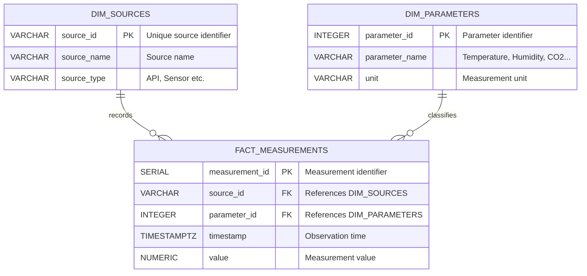

# Environment Data Project

A Python-based ETL (Extract, Transform, Load) application that collects weather and environmental data from the Danish Meteorological Institute (DMI) API, processes the data, and stores it in a PostgreSQL database.

This project demonstrates database integration, API consumption, containerized development, automated testing, and object-oriented programming principles.

---

## Features

- Extract weather and environmental data from the DMI API
- Transform raw API responses into a structured format
- Load processed data into PostgreSQL
- Containerized development environment using Docker Compose
- Database management through pgAdmin
- Automated testing with Pytest
- Clean, maintainable, and object-oriented Python code
- Type hints, docstrings, and PEP 8 compliant codebase

---

## Technology Stack

- **Python 3**
- **PostgreSQL**
- **Docker & Docker Compose**
- **Psycopg**
- **Requests**
- **Pytest**
- **pgAdmin**

---

## Project Structure

```text
environment_data_project/
├── app/
│   ├── constants/
│   ├── extract/
│   │   ├── base.py
│   │   └── dmi.py
│   ├── database.py
│   ├── etl_service.py
│   ├── load.py
│   ├── main.py
│   └── transform.py
├── tests/
│   ├── integration/
│   │   └── test_postgres.py
│   └── unit/
├── docker-compose.yml
├── requirements.txt
└── README.md
```

---

## Getting Started

### Prerequisites

- Docker Desktop
- Git

### Clone the Repository

```bash
git clone https://github.com/mielouise/environment_data_project.git
cd environment_data_project
```

### Start the Application

```bash
docker compose up --build app
```

## Running Tests

The test suite includes integration tests that connect to PostgreSQL and the
DMI API. Ensure the database settings and `DMI_API_URL` are configured in
`.env`, and that the test environment can reach the DMI API.

```bash
docker compose run --build --rm tests
```

### Access pgAdmin

```bash
docker compose up -d pgadmin
```

Open:

```text
http://localhost:8080
```

Login using the credentials defined in the `.env` file.

---


## ETL Workflow

1. Extract data from the DMI API.
2. Transform the data into the required database format.
3. Load the processed data into PostgreSQL.
4. Validate functionality through automated tests.

---

## Database Schema



---

## Learning Objectives

This project was developed to demonstrate:

- REST API integration
- ETL pipeline implementation
- PostgreSQL database design and management
- Docker-based development environments
- Automated testing practices
- Object-oriented Python development

---

## Author

**Mie Louise Nielsen**

GitHub: https://github.com/mielouise