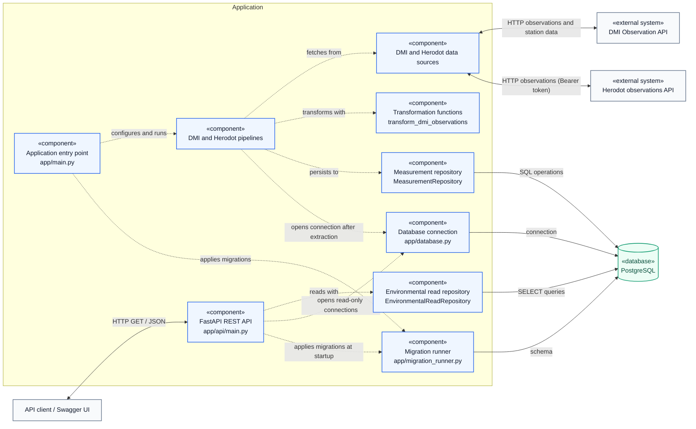
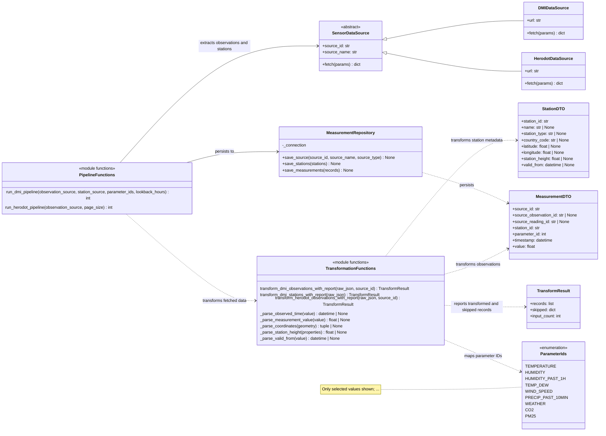
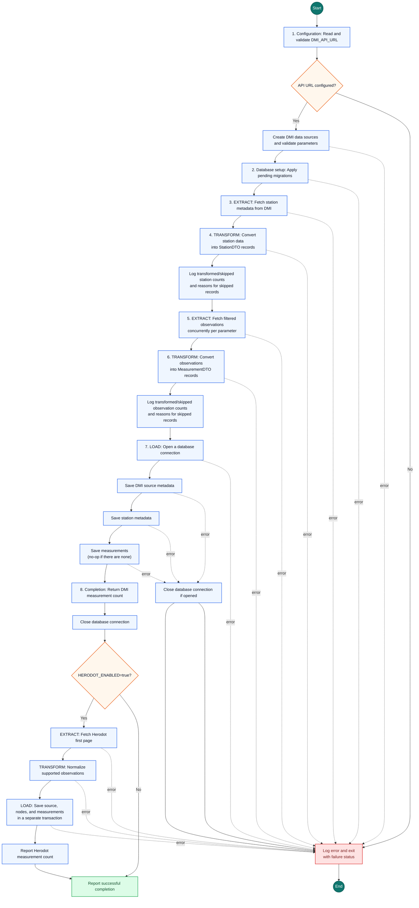
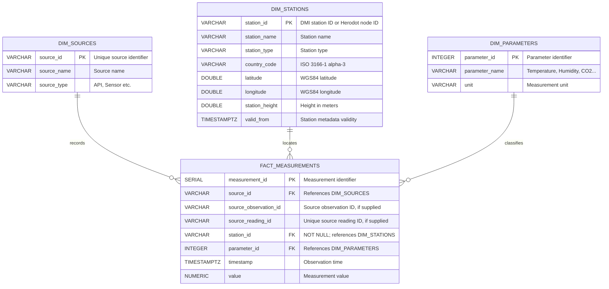

# Environment Data Project

A Python ETL application that retrieves environmental observations from the
Danish Meteorological Institute (DMI) and, when enabled, the Herodot sensor
API. It transforms supported measurements and stores them in PostgreSQL. A
local FastAPI REST API exposes the imported measurements, stations, and
parameter metadata as JSON.

The project is organized into extraction, transformation, and persistence
components, with versioned database migrations and automated unit and
integration tests.

---

## Contents

- [Features](#features)
- [Technology stack](#technology-stack)
- [Getting started](#getting-started)
- [Local REST API](#local-rest-api)
- [Project structure](#project-structure)
- [File overview](#file-overview)
- [Architecture](#architecture)
- [Learning objectives](#learning-objectives)
- [Author](#author)

---

## Features

- Retrieve environmental observations from the DMI API and optionally from
  the Herodot sensor API
- Filter observations by parameter and a rolling time window at the API
- Fetch parameter-filtered observations concurrently, with a five-request
  limit to avoid unbounded load on DMI
- Transform the documented DMI meteorological observation parameters,
  including categorical weather and snow-cover codes
- Store source metadata, station locations, and measurements in PostgreSQL
- Compare observations across sources, stations, and parameters through the
  REST API
- Import one Herodot response page (100 observations) when explicitly enabled
- Apply versioned SQL migrations automatically at startup
- Run one ETL cycle per application invocation
- Query imported data through a versioned REST API with filters and pagination
- Explore and call endpoints through generated Swagger/OpenAPI documentation
- Run unit and integration tests with Pytest
- Use Docker Compose for local development and execution
- Manage the database through pgAdmin

## Assignment alignment

- **API-based collection and ETL:** DMI data is extracted, validated and
  transformed, then loaded into PostgreSQL. Herodot is an optional additional
  source and currently imports its first response page only.
- **Database server and warehouse model:** PostgreSQL stores sources,
  parameters, stations/sensor nodes, and measurements in related tables.
- **Cross-station and cross-source comparison:** The REST API exposes
  measurements with source, station, parameter, and time filters.
- **Automated testing:** The CI workflow enforces at least 95% unit-test
  coverage and runs integration tests.
- **Documentation and UML:** This README contains build, run, test, software
  architecture, and Mermaid component, class, workflow, and ER diagrams.
- **GitHub delivery:** A GitHub remote is configured for this repository.
  Verify that the supervisors have permission to access it in GitHub settings.

---

## Technology stack

- **Python 3.12**
- **PostgreSQL**
- **Docker & Docker Compose**
- **Psycopg**
- **Requests**
- **FastAPI & Uvicorn**
- **Pytest**
- **pgAdmin**

---

## Getting started

### Prerequisites

- Git
- Docker Desktop with Docker Compose

### Clone the repository

```bash
git clone https://github.com/mielouise/environment_data_project.git
cd environment_data_project
```

### Configure environment variables

Create a local `.env` file from the committed example before starting the
project:

```powershell
Copy-Item .env.example .env
```

Keep `POSTGRES_HOST=db` and `POSTGRES_PORT=5432` when running the services
with Docker Compose. The example database name, database username, passwords,
and pgAdmin email are configurable; replace the example credentials before
using the project outside local development. `.env` is ignored by Git; do not
commit real credentials.

The current ETL application requires `DMI_API_URL` and the five `POSTGRES_*`
variables. The pgAdmin variables are needed only when starting the `pgadmin`
service. `DMI_PARAMETER_IDS` is optional and defaults to air temperature and
humidity observations. `SENSOR_API_URL` and `SENSOR_API_TOKEN` configure the
Herodot extractor. Set `HERODOT_ENABLED=true` to run a one-page Herodot
import after DMI. Herodot observations are stored with node IDs as station IDs;
unknown station names and locations remain null rather than being fabricated.
The current import requests one page of 100 observations; it does not follow
pagination, and the API's ordering has not been confirmed. Herodot pressure
values are provisionally treated as Pa and converted to hPa. Confirm this unit
with the provider before using pressure comparisons as evidence.

| Variable | Required | Description |
|----------|----------|-------------|
| `DMI_API_URL` | Yes | Short DMI API base URL, for example `https://opendataapi.dmi.dk` (or the base URL of a local API). The application adds the API version, collection, and `/items` endpoint in code. |
| `POSTGRES_HOST` | Yes | Keep `db` for Docker Compose; it is the Compose database service name. |
| `POSTGRES_PORT` | Yes | Keep `5432` for Docker Compose. |
| `POSTGRES_DB` | Yes | Database name; the example value can be changed. |
| `POSTGRES_USER` | Yes | Database username; the example value can be changed. |
| `POSTGRES_PASSWORD` | Yes | Database password; set a suitable value for your environment. |
| `PGADMIN_USER_EMAIL` | For pgAdmin | Sign-in email; the example value can be changed. |
| `PGADMIN_PASSWORD` | For pgAdmin | Sign-in password; set a suitable value for your environment. |
| `DMI_PARAMETER_IDS` | No | Comma-separated DMI parameter IDs. Leave blank to use the default: `temp_dry,humidity`. |
| `HERODOT_ENABLED` | No | Set `true` to run Herodot after DMI; defaults to `false`. |
| `SENSOR_API_URL` | For Herodot | Herodot observations endpoint; defaults to `https://herodot.spac.dk/api/v1/observations`. |
| `SENSOR_API_TOKEN` | When Herodot is enabled | Secret Bearer token. Store only in local `.env`; do not commit or share it. |

The application builds the versioned observation and station item endpoints
from `DMI_API_URL` in code, appending
`/v2/metObs/collections/observation/items` and
`/v2/metObs/collections/station/items`.

### Start the application

```bash
docker compose up --build app
```

This builds and starts the application together with its PostgreSQL
dependency. The application initializes the database schema and runs the ETL
workflow: it requests observations from the DMI API, transforms them, and
saves the source, station locations, and measurements to PostgreSQL. When
`HERODOT_ENABLED=true`, it also imports only Herodot's first observation page.
By default, it requests only air temperature (`temp_dry`) and humidity
(`humidity`) for Denmark, limited to the previous 24 hours. Each selected
parameter is sent directly to DMI as a `parameterId` query filter, avoiding
requests for unrelated observation types. The pipeline also supports all
documented parameter identifiers, including categorical observations; the
DMI observation catalogue does not include the legacy CO2 and PM2.5 database
parameters. The default selection is intentionally narrow to keep request
volume manageable; expand it with `DMI_PARAMETER_IDS` when the downstream use
case requires additional measurements. Each application invocation is a
one-shot run.

Set `DMI_PARAMETER_IDS` to any comma-separated subset of documented parameter
identifiers to change the selection and reduce API traffic further:

```bash
docker compose run --rm -e DMI_PARAMETER_IDS=temp_dry,humidity app
```

The application reads `DMI_API_URL` as the short API base URL and constructs
the versioned observation and station `items` endpoints in code.
Station coordinates are taken from the GeoJSON response and measurements
retain their DMI station ID. The observation and station collections are
listed in the [DMI API collections
catalogue](https://opendataapi.dmi.dk/v2/metObs/collections); available
parameters and units are documented in the [DMI meteorological observations
catalogue](https://www.dmi.dk/friedata/dokumentation/meteorological-observations-data#c24107).

Each application invocation runs one ETL cycle, reports the number of
processed observations, and exits. To run it again, start the command again.
If malformed or unsupported records are skipped during transformation, the
application logs a summary by stage and reason, such as missing required
fields, `missing_station_id`, unsupported parameter, invalid timestamp, or
invalid coordinates.

To start pgAdmin and its PostgreSQL dependency for database inspection:

```bash
docker compose up -d pgadmin
```

Open pgAdmin at:

```text
http://localhost:8080
```

Sign in with the pgAdmin credentials configured in `.env`.

When finished, stop and remove the containers with:

```bash
docker compose down
```

The PostgreSQL data volume is retained when the containers are stopped this
way.

### Testing

Run the unit tests and enforce the required minimum of 95% source coverage:

```bash
docker compose run --build --rm tests pytest tests/unit --cov=app --cov-report=term-missing --cov-fail-under=95
```

Run integration tests separately. They connect to PostgreSQL and make a real
request to the configured DMI API, so database configuration, valid DMI
settings, and network access to DMI are required:

```bash
docker compose run --build --rm tests pytest tests/integration -v
```

Run all tests together with:

```bash
docker compose run --build --rm tests
```

Check lint rules, Google-style docstrings, and formatting with Ruff:

```bash
docker compose run --build --rm --no-deps tests ruff check app tests
docker compose run --build --rm --no-deps tests ruff format --check app tests
```

The GitHub Actions workflow runs the style checks, enforces 95% unit-test
coverage, and runs the integration tests on pull requests to `main`.

---

## Local REST API

After configuring `.env`, load DMI data and optionally Herodot data using the
standard application command:

```bash
docker compose up --build app
```

Wait for the ETL completion message. If Compose remains attached after
`app_service` exits, press Ctrl+C before starting the API. The API command
starts PostgreSQL again if needed:

```bash
docker compose up --build -d api
```

If the required data is already stored, only the API command is needed. Open
[Swagger UI](http://localhost:8000/docs) to see the endpoints and try requests.
The API applies pending database migrations at startup and reads PostgreSQL;
it does not trigger ETL runs or make requests to upstream sources. The Docker
port is bound to `127.0.0.1:8000` for local access.

Example request in PowerShell (use `curl` on Linux/macOS):

```powershell
curl.exe "http://localhost:8000/api/v1/measurements?parameter_id=1&limit=2"
```

This returns up to two imported temperature measurements as JSON, including
station ID, timestamp, numeric value, and unit. Use `/api/v1/parameters` to
discover imported parameter IDs and `/api/v1/stations` to discover stations.
Measurements support `station_id`, `parameter_id`, timezone-aware `start` and
`end`, and `limit`/`offset` pagination. Data endpoints use the `/api/v1` prefix;
`/health` checks database connectivity.

See the [API user guide](docs/API.md) for the complete endpoint reference,
setup instructions, request and response examples, error codes, data semantics,
and test commands. The guide also walks through the flow from DMI and Herodot
imports to validated JSON responses, with the responsibilities of each API
module and the project's documentation and typing conventions.
Machine-readable documentation is at
[/openapi.json](http://localhost:8000/openapi.json).

---

## Project structure

```text
environment_data_project/
├── .devcontainer/
│   ├── Dockerfile
│   ├── devcontainer-lock.json
│   └── devcontainer.json
├── app/
│   ├── __init__.py
│   ├── api/
│   │   ├── __init__.py
│   │   ├── main.py
│   │   ├── models.py
│   │   └── repository.py
│   ├── constants/
│   │   ├── __init__.py
│   │   └── parameters.py
│   ├── extract/
│   │   ├── __init__.py
│   │   ├── base.py
│   │   ├── dmi.py
│   │   └── herodot.py
│   ├── load/
│   │   ├── __init__.py
│   │   └── measurement_repository.py
│   ├── transform/
│   │   ├── __init__.py
│   │   ├── dmi.py
│   │   ├── herodot.py
│   │   ├── models.py
│   │   └── stations.py
│   ├── database.py
│   ├── migration_runner.py
│   ├── migrations/
│   │   ├── 0001_initial_schema.sql
│   │   ├── 0002_station_locations.sql
│   │   ├── 0003_dmi_observation_parameters.sql
│   │   ├── 0004_station_name.sql
│   │   ├── 0005_require_measurement_station.sql
│   │   ├── 0006_allow_unknown_station_metadata.sql
│   │   └── 0007_preserve_source_reading_ids.sql
│   ├── main.py
│   └── pipeline.py
├── docs/
│   └── API.md
├── pgadmin/
│   └── servers.json
├── tests/
│   ├── __init__.py
│   ├── integration/
│   │   ├── __init__.py
│   │   ├── test_dmi_api.py
│   │   ├── test_postgres.py
│   │   └── test_rest_api.py
│   └── unit/
│       ├── __init__.py
│       ├── test_api.py
│       ├── test_api_repository.py
│       ├── test_database.py
│       ├── test_extract.py
│       ├── test_herodot_extract.py
│       ├── test_herodot_transform.py
│       ├── test_load.py
│       ├── test_migrations.py
│       ├── test_main.py
│       ├── test_pipeline.py
│       ├── test_stations.py
│       └── test_transform.py
├── .dockerignore
├── .github/
│   └── workflows/
│       └── ci.yml
├── .gitignore
├── .env.example
├── Dockerfile
├── docker-compose.yml
├── pyproject.toml
├── requirements-dev.txt
├── requirements.txt
└── README.md
```

## File overview

- The `app` directory contains the application code. Docker starts the
  application through `app/main.py`, which configures and runs the pipeline.
- The `app/extract` directory contains the clients for retrieving data from
  DMI and Herodot, including a shared abstraction for data sources.
- The `app/transform` directory contains pure transformation functions,
  parsing helpers, transformation reports, and measurement and station data
  models.
- The `app/load` directory contains persistence components.
- The `app/constants` directory contains shared constants, including IDs for
  the supported measurement parameters.
- The [app/api](app/api/) directory contains the FastAPI entry point, public response
  models, and read-only PostgreSQL queries. The `api` Compose service runs
  this independently of the one-shot ETL application.
- [docs/API.md](docs/API.md) documents the REST API, local setup, filters,
  pagination, acceptance checks, errors, and examples.
- The `app/migrations` directory contains versioned SQL scripts for creating
  and updating the database schema.
- `app/pipeline.py` defines the DMI and Herodot extract-transform-load flows.
- `pyproject.toml` configures Ruff linting and formatting rules.
- `app/database.py` manages database connections, while
  `app/migration_runner.py` discovers and applies SQL migrations.
- The `tests` directory contains the test suite, which is run by the `tests`
  service in Docker Compose. It is divided into two subdirectories:
  - The `tests/unit` directory contains unit tests that test application code
    in isolation from external systems, for example by using mocks.
  - The `tests/integration` directory contains integration tests that verify
    connections to external systems. `test_postgres.py` tests the connection
    to PostgreSQL, and `test_dmi_api.py` sends a request to the configured DMI
    API. [test_rest_api.py](tests/integration/test_rest_api.py) verifies HTTP
    filtering and pagination against isolated temporary PostgreSQL tables.
- `Dockerfile` defines the Docker image for the application and tests.
  `docker-compose.yml` configures the ETL app, API, test, PostgreSQL, and pgAdmin
  services.
- `.gitignore` specifies which files Git should ignore, such as local
  environment settings. `.dockerignore` specifies which files to exclude from
  the Docker build context.
- `requirements.txt` lists the Python packages required by the application.
  `requirements-dev.txt` includes these packages along with additional
  packages needed for development and testing.
- The `.devcontainer` directory contains the development container
  configuration, and the `pgadmin` directory contains the pgAdmin
  configuration.
- `README.md` contains the project description, setup instructions, and
  database schema documentation.

---

## Architecture

The diagrams below describe the solution from four different
perspectives:

1. Application component architecture
2. Implementation design
3. Runtime ETL workflow
4. Database design

Together these views document the system at component, implementation,
execution, and database levels.

### Application component overview

- Shows the main application components and their responsibilities.
- Shows how the application communicates with DMI, Herodot, and PostgreSQL.



### Implementation relationships

- Shows the source and repository classes alongside the ETL functions.
- The solid inheritance arrows show that `DMIDataSource` and
  `HerodotDataSource` extend `SensorDataSource`.
- The dashed dependencies show how the pipeline connects extraction,
  transformation, and persistence.



### ETL workflow

The activity diagram below shows one ETL run, including database migrations,
transactional writes, error handling, and connection cleanup.



The workflow proceeds as follows:

1. **Configuration:** Read and validate `DMI_API_URL`, create the observation
   and station data sources, and validate the selected parameter IDs.
2. **Database setup:** Apply pending migrations to create or update the schema.
3. **Extract stations:** Fetch station metadata from DMI.
4. **Transform stations:** Convert the fetched metadata into station records.
5. **Extract observations:** Fetch observations concurrently for the selected
   parameters.
6. **Transform observations:** Convert the fetched data into measurement
   records.
7. **Load:** Save source metadata, station metadata, and measurements in one
   database transaction. The repository skips measurement SQL when there are
   no measurements. A failed load rolls back its writes.
8. **Completion:** Close the DMI database connection and report its processed
   measurement count. If `HERODOT_ENABLED=true`, fetch and transform one
   Herodot page, then save its source, sensor nodes, and measurements in a
   separate transaction. Report failures and exit with a failure status.

#### Database migrations

The application applies pending SQL migrations automatically before starting
the ETL workflow. Migration scripts live in `app/migrations/` and are named
with a unique, increasing version and a descriptive name, for example
`0001_initial_schema.sql`. Applied versions and SHA-256 checksums are stored
in the PostgreSQL `schema_migrations` table. Migrations run in a transaction,
and a database advisory lock prevents concurrent application instances from
applying the same migration simultaneously.

The initial migration creates the original schema using idempotent
statements, so an existing database created by an earlier version of this
project can adopt migration tracking without dropping its tables or
measurement data. Later migrations add station metadata, the complete DMI
parameter catalogue, rename the station name column to `station_name`, require
each measurement to reference a station, and allow unknown Herodot node
metadata to remain null. Migration `0007_preserve_source_reading_ids.sql`
stores Herodot source IDs and preserves separate readings that share a
station, parameter, and timestamp.

Before applying `0005_require_measurement_station.sql` to an existing database,
check for measurements without a station:

```sql
SELECT COUNT(*)
FROM fact_measurements
WHERE station_id IS NULL;
```

If the count is not zero, identify and resolve those records using a reliable
source for their station IDs before applying the migration. The migration
deliberately fails rather than assigning or deleting station data
automatically.

After confirming the count is zero, start the application to apply pending
migrations:

```bash
docker compose up --build app
```

Migrations run automatically during ETL startup, before the ETL cycle. The
command above therefore requires valid DMI and database configuration. The
API service also applies pending migrations at startup without running ETL
or requiring DMI configuration.

After a migration has been committed, do not edit or rename it. To change the
schema, add a new migration file with the next version, such as
`0008_add_station_history.sql`. This preserves a consistent upgrade path for
existing installations.

### Database design

The database follows a normalized dimensional design consisting of one
fact table and three dimension tables.

This design was chosen to reduce data redundancy, improve data integrity,
and make it easier to extend the solution with additional environmental
measurement types in the future.

#### Dimension tables

##### DIM_SOURCES

Stores metadata describing each measurement source.

Examples:

- DMI Observation API
- Future environmental APIs
- Sensor networks

##### DIM_PARAMETERS

Stores metadata describing measurable environmental parameters and
their associated units.

Examples:

| ID | Parameter | Unit |
|----|-----------|------|
| 1 | Temperature | °C |
| 2 | Humidity | % |
| 3 | Humidity Past 1 Hour | % |
| 4 | CO2 | ppm |
| 5 | PM2.5 | μg/m³ |

Migration `0003_dmi_observation_parameters.sql` adds all DMI parameters in
the meteorological observations catalogue. Numeric enum codes (for example
weather codes) are stored in the same numeric value column as measurements
and use the `enum` unit to distinguish them from physical quantities.

#### Fact table

##### FACT_MEASUREMENTS

Stores individual environmental observations.

Each measurement references:

- one source
- one station
- one parameter

through foreign-key relationships.

The schema also includes an idempotency key appropriate to the source:

```sql
(source_id, station_id, parameter_id, timestamp) -- legacy/DMI readings
(source_id, source_reading_id)                   -- readings with a source ID
```

Herodot's `observationId` and `readingId` are retained with each measurement.
The stable `readingId` identifies a Herodot reading across repeated ETL runs,
while distinct readings at the same node, parameter, and timestamp remain
separate rows. If a Herodot record has no `readingId`, it is inserted without
timestamp-based upsert to avoid collapsing potentially distinct readings;
such rows may repeat on later runs.

#### Entity relationship diagram

The ER diagram describes the PostgreSQL data model and the relationships
between its tables.



- `DIM_SOURCES` stores metadata about each data source, including its name and
  type.
- `DIM_PARAMETERS` defines the measured parameters and their units.
- `DIM_STATIONS` stores the station identity and its latest known location.
- `FACT_MEASUREMENTS` stores each environmental observation's timestamp and
  numeric value and retains source-provided observation/reading identifiers
  when available.
- Each measurement references exactly one source, station, and parameter
  through foreign keys.
- A source, station, and parameter can each be referenced by multiple
  measurements.
- Separating measurements from descriptive metadata supports consistent
  storage and analysis across sources and parameters.

---

## Learning objectives

After completing this project, participants should be able to:

- **Apply ETL principles:** separate extraction, transformation, and loading
  responsibilities.
- **Integrate external APIs:** process API responses and handle missing,
  unexpected, or erroneous data.
- **Design comparable data models:** structure measurements from multiple
  sources and justify the schema.
- **Use PostgreSQL:** configure a database and write data from application code.
- **Build reliable pipelines:** support repeated runs without duplicate or
  destructive writes.
- **Test integrations effectively:** isolate external services in unit tests
  and target at least 95% test coverage.
- **Plan for data reuse:** consider how collection choices support future
  analysis, including workplace environmental quality.
- **Deliver professionally:** maintain the remote repository and document
  setup, build, testing, execution, architecture, and UML in the README.

---

## Author

**Mie Louise Nielsen**

GitHub: https://github.com/mielouise
