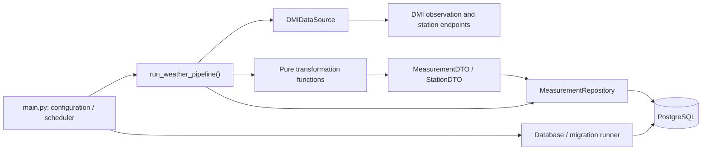
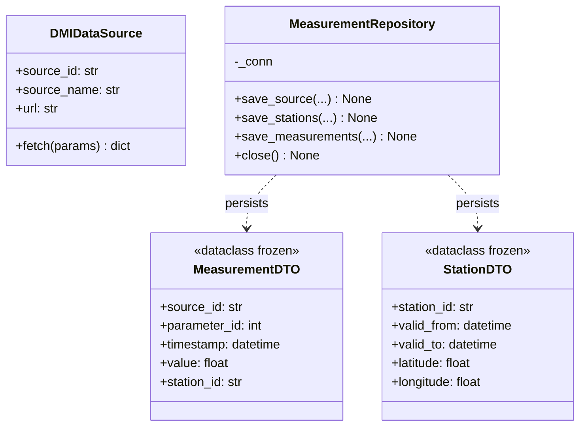
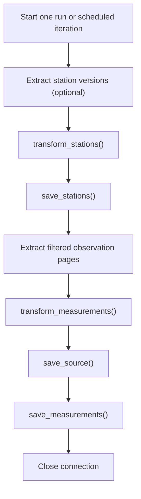
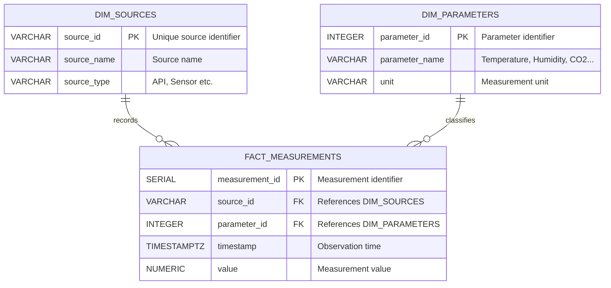
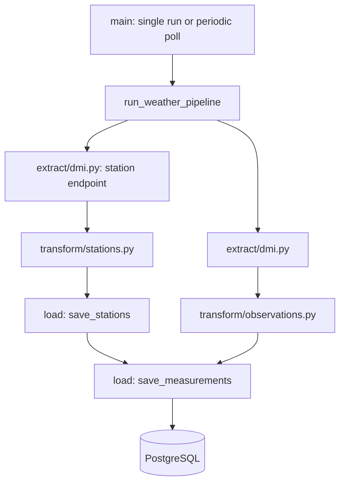

# Environment Data Project

A Python ETL application that retrieves environmental observations from the
Danish Meteorological Institute (DMI), transforms supported measurements, and
stores them in PostgreSQL.

The project is organized into extraction, transformation, and persistence
components, with versioned database migrations and automated unit and
integration tests.

---

## Contents

- [Features](#features)
- [Technology stack](#technology-stack)
- [Getting started](#getting-started)
- [Project structure](#project-structure)
- [File overview](#file-overview)
- [Architecture](#architecture)
- [Learning objectives](#learning-objectives)
- [Author](#author)

---

## Features

- Retrieve environmental observations from the DMI API
- Transform selected meteorological temperature and humidity observations
- Store source metadata and measurements in PostgreSQL
- Apply versioned SQL migrations automatically at startup
- Run unit and integration tests with Pytest
- Use Docker Compose for local development and execution
- Manage the database through pgAdmin

---

## Technology stack

- **Python 3**
- **PostgreSQL**
- **Docker & Docker Compose**
- **Psycopg**
- **Requests**
- **Pytest**
- **pgAdmin**

---

## Getting started

### Prerequisites

- Git
- Docker Desktop with Docker Compose

### Clone the repository

```bash
git clone https://github.com/mielouise/environment_data_project.git
cd environment_data_project
```

### Start the application

```bash
docker compose up --build app
```

This builds and starts the application together with its PostgreSQL
dependency. The application initializes the database schema and runs the ETL
workflow: it requests observations from the DMI API, transforms them, and
saves the source and measurements to PostgreSQL.

To start PostgreSQL and pgAdmin for database inspection:

```bash
docker compose up -d db pgadmin
```

Open pgAdmin at:

```text
http://localhost:8080
```

Sign in with the pgAdmin credentials configured in `.env`.

When finished, stop and remove the containers with:

```bash
docker compose down
```

The PostgreSQL data volume is retained when the containers are stopped this
way.

### Testing

Run the complete test suite, including the unit tests and integration tests:

```bash
docker compose run --build --rm tests
```

The test service waits for PostgreSQL to become healthy. Integration tests
connect to the configured PostgreSQL database and make a real request to the
DMI API, so the corresponding environment variables must be configured and
the environment must have network access to DMI.

---

## Project structure

```text
environment_data_project/
├── app/
│   ├── constants/
│   ├── extract/
│   │   ├── base.py
│   │   ├── dmi.py
│   │   └── stations.py
│   ├── transform/
│   │   ├── observations.py
│   │   └── stations.py
│   ├── load/
│   │   └── repository.py
│   ├── pipelines/
│   │   └── weather_pipeline.py
│   ├── migrations/
│   │   ├── 0001_initial_schema.sql
│   │   └── 0002_add_stations.sql
│   ├── database.py
│   ├── migration_runner.py
│   ├── main.py
├── tests/
│   ├── unit/
│   └── integration/
├── docker-compose.yml
└── README.md
```

## File overview

The application follows four consistent ETL stage directories:

- `app/extract/`: one small `DMIDataSource` HTTP client for observations and stations, including API filters and pagination.
- `app/transform/`: pure, separately testable functions and immutable measurement/station DTOs.
- `app/load/`: `MeasurementRepository` encapsulates PostgreSQL persistence, station versions and measurement upserts.
- `app/pipelines/`: `run_weather_pipeline()` explicitly defines execution order and dependencies.

`app/main.py` configures execution and scheduling; `app/database.py` handles connections; `app/migration_runner.py` handles schema migration tracking. SQL changes are in `app/migrations/`. Tests are separated into `tests/unit/` and `tests/integration/`.

## Architecture

The design favors **single responsibility**, small functions, descriptive names, and pragmatic object orientation. Classes are used for the HTTP client, repository, and immutable data transfer objects because they have meaningful shared behavior or structure. No abstract base class or service wrapper is introduced for a single concrete implementation.

### Component diagram



### UML class diagram



The pipeline and transformation stages use functions, so they are intentionally not modeled as unnecessary classes.

### ETL workflow



### Database design

The database follows a normalized dimensional design consisting of one
fact table and two dimension tables.

This design was chosen to reduce data redundancy, improve data integrity,
and make it easier to extend the solution with additional environmental
measurement types in the future.

#### Dimension tables

##### DIM_SOURCES

Stores metadata describing each measurement source.

Examples:

- DMI Observation API
- Future environmental APIs
- Sensor networks

##### DIM_PARAMETERS

Stores metadata describing measurable environmental parameters and
their associated units.

Examples:

| ID | Parameter | Unit |
|----|-----------|------|
| 1 | Temperature | °C |
| 2 | Humidity | % |
| 3 | Humidity Past 1 Hour | % |
| 4 | CO2 | ppm |
| 5 | PM2.5 | μg/m³ |

#### Fact table

##### FACT_MEASUREMENTS

Stores individual environmental observations.

Each measurement references:

- one source
- one parameter

through foreign-key relationships.

The schema also includes a unique constraint on:

```sql
(source_id, parameter_id, timestamp)
```

#### Entity relationship diagram

The ER diagram describes the PostgreSQL data model and the relationships
between its tables.



- `DIM_SOURCES` stores metadata about each data source, including its name and
  type.
- `DIM_PARAMETERS` defines the measured parameters and their units.
- `FACT_MEASUREMENTS` stores each environmental observation's timestamp and
  numeric value.
- Each measurement references exactly one source and one parameter through
  foreign keys.
- A source and a parameter can each be referenced by multiple measurements.
- Separating measurements from descriptive metadata supports consistent
  storage and analysis across sources and parameters.

---

## Learning objectives

After completing this project, participants should be able to:

- **Apply ETL principles:** separate extraction, transformation, and loading
  responsibilities.
- **Integrate external APIs:** process API responses and handle missing,
  unexpected, or erroneous data.
- **Design comparable data models:** structure measurements from multiple
  sources and justify the schema.
- **Use PostgreSQL:** configure a database and write data from application code.
- **Build reliable pipelines:** support repeated runs without duplicate or
  destructive writes.
- **Test integrations effectively:** isolate external services in unit tests
  and target at least 95% test coverage.
- **Plan for data reuse:** consider how collection choices support future
  analysis, including workplace environmental quality.
- **Deliver professionally:** maintain the remote repository and document
  setup, build, testing, execution, architecture, and UML in the README.

---

## Author

**Mie Louise Nielsen**

GitHub: https://github.com/mielouise


---

## Runde 2: architecture and operations

The application now exposes one concrete orchestration function, `run_weather_pipeline()`, rather than requiring every pipeline to follow a one-source/one-transform/one-destination pattern. Station metadata is loaded before weather measurements; observations are fetched separately for each requested meteorological parameter. Transformations are split into small functions and placed in `app/transform/`, while persistence is in `app/load/`. Legacy imports are kept for compatibility.



The connection helpers remain in `app/database.py`, whereas migration tracking, SHA-256 checksums, transaction handling and advisory locking have moved to `app/migration_runner.py`. SQL migration `0001_initial_schema.sql` is unchanged. The new `0002_add_stations.sql` adds a station dimension and a nullable station foreign key to the fact table. The uniqueness key now contains `station_id` to prevent observations from different stations overwriting each other. Missing station IDs in historical records stay NULL; station IDs not returned by the station endpoint are still retained as minimal dimension records.

### Environment configuration

| Variable | Default | Purpose |
|---|---|---|
| `DMI_API_URL` | Meteorological observations endpoint (in Compose) | Observations items endpoint |
| `DMI_STATIONS_URL` | DMI meteorological stations endpoint | Station metadata items endpoint |
| `DMI_PARAMETER_IDS` | `temp_dry,humidity` | Comma-separated requested parameter types |
| `DMI_STATION_ID` | unset | Optional DMI station ID filter |
| `DMI_LOOKBACK_MINUTES` | `60` | Sliding lookback period for late-arriving observations |
| `DMI_PAGE_SIZE` | `1000` | Maximum features requested per page |
| `DMI_POLL_SECONDS` | `0` in Python; `300` in Compose | 0 = run once; greater than 0 = repeat |
| `DMI_FETCH_STATIONS` | `true` | Whether to refresh station metadata |

To run continuously:

```bash
docker compose up --build app
```

For an individual cycle, override `DMI_POLL_SECONDS=0`. To run tests, use:

```bash
docker compose run --build --rm tests
```

The observation client sends `parameterId`, `datetime`, `limit` and `offset` to the DMI API rather than downloading everything and filtering only locally. `stationId` is sent when configured. Overlapping time windows are intentional: database upserts make repeated ingestion idempotent. A per-query safety cap is imposed to prevent runaway pagination. Each request has a network timeout; a failed polling cycle is logged and retried on the next scheduled cycle.

### Parameter selection and limitations

The pre-existing dimension includes `temp_dry`, `humidity`, `humidity_past1h`, `co2` and `pm25`. **Only `temp_dry` and `humidity` are configured by default.** Other internal mappings are retained for compatibility, but the meteorological observation collection does not necessarily provide every mapped environmental variable. Unsupported parameters are not blindly added to the database: each addition requires confirmation of the provider's documented parameter names and units, a matching dimension entry, and tests. This is why the project intentionally does not collect all available DMI measurements.

Stations have geographical point coordinates, and observations reference their IDs. The additional `0003_station_history.sql` migration preserves individual DMI metadata versions in `dim_station_versions`; measurements can be linked to the station version valid at observation time.

See the existing sections above for installation and the original database design, plus the newer relationships explained here.

### DMI API capabilities and endpoints

The [Capabilities API](https://python-dmi-open-data.readthedocs.io/en/latest/metobs/CapabilitiesApi/) describes collection discovery and service metadata, including `GET /v2/metObs/collections`, `GET /v2/metObs/collections/observation` and `GET /v2/metObs/collections/station`. These are **not** observation data endpoints. This ETL reads item data directly from the [MetObservationApi](https://python-dmi-open-data.readthedocs.io/en/latest/metobs/MetObservationApi/) and [MetStationApi](https://python-dmi-open-data.readthedocs.io/en/latest/metobs/MetStationApi/) endpoints (`.../items`), and needs no separate SDK dependency because existing code uses `requests`. The SDK examples describe optional `datetime`, `station_id`/`stationId`, `parameter_id`/`parameterId`, `limit` and `offset` filters; use the HTTP wire names `stationId` and `parameterId` in actual query strings.

Parameter and collection availability can be explored through the capabilities endpoints, but parameter names must still be checked against DMI's meteorological observation catalog.


### DMI source-of-truth refinements: stations and observation parameters

DMI's official documentation:
- [Meteorological Observation Data Stations](https://www.dmi.dk/friedata/dokumentation/data/meteorological-observation-data-stations)
- [Meteorological Observations Data](https://www.dmi.dk/friedata/dokumentation/meteorological-observations-data#c24107)

Stations have a stable `stationId`, while metadata can change. Versioned properties include `validFrom` and `validTo`. The pipeline now stores all available dated station versions in `dim_station_versions` using `(station_id, valid_from)` as the historical identifier, while keeping `dim_stations` for stable station identity and latest-known coordinates. `fact_measurements.station_version_id` identifies the version valid at the `observed` timestamp using a half-open interval `[valid_from, valid_to)`; when no matching version is available, it remains NULL rather than inventing a historical location. Migration `0003_station_history.sql` extends earlier migrations without editing them.

For the meteorological observation collection the active transform mapping accepts `temp_dry`, `humidity`, and `humidity_past1h` only. The prior `co2` and `pm25` mapping was removed because these are not established parameters in the referenced metObs data catalog. Their original `dim_parameters` seed rows remain in the existing immutable migration for compatibility; **they are not fetched or stored by this metObs pipeline**. The default requested parameters remain `temp_dry,humidity`.

**Historical coverage caveat:** The station API query must return dated historical versions if historical spatial analysis is required. If only current metadata is returned, the system cannot reconstruct earlier station coordinates. Temporal joins are only as complete as the fetched station history.
