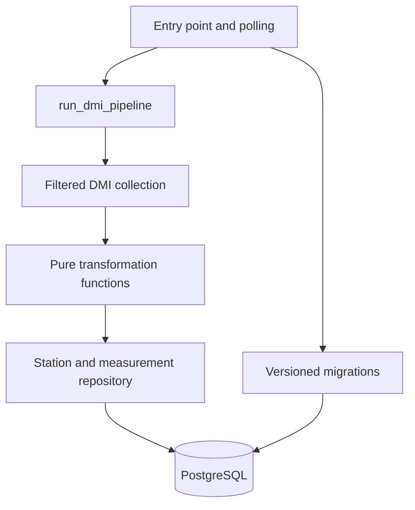
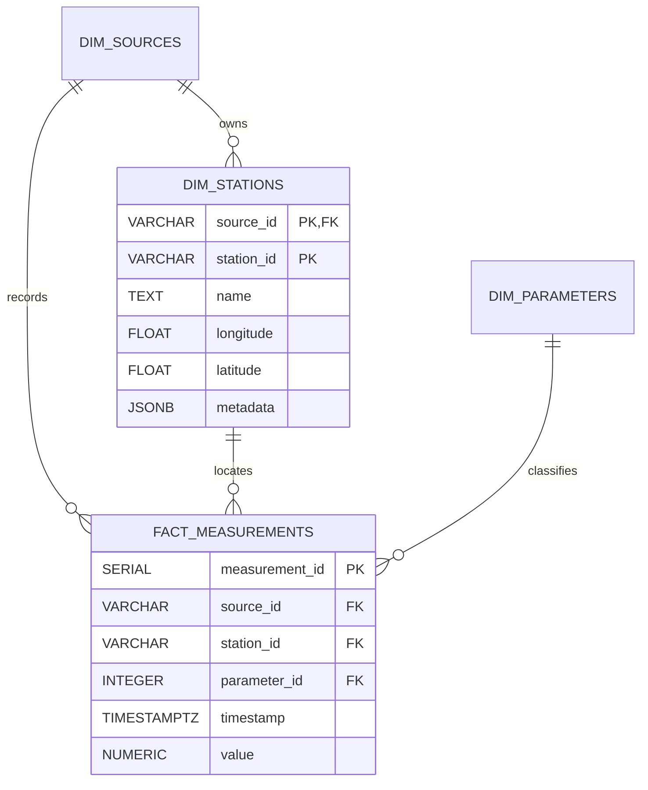

# Environment Data Project

Python ETL application collecting selected DMI meteorological observations
and station metadata in PostgreSQL. Extraction, pure transformation functions,
and persistence have separate packages. `run_dmi_pipeline` explicitly describes
the concrete workflow, so additional sources, transformations or destinations can
be inserted where their dependencies require them.

## Getting started

Requires Git and Docker Compose (PostgreSQL 16).

```bash
git clone https://github.com/mielouise/environment_data_project.git
cd environment_data_project
```

Create `.env` with the database settings used by `docker-compose.yml`:

```dotenv
POSTGRES_HOST=db
POSTGRES_PORT=5432
POSTGRES_DB=postgres_db
POSTGRES_USER=admin
POSTGRES_PASSWORD=change-me
DMI_API_URL=https://opendataapi.dmi.dk/v2/metObs/collections/observation/items
PGADMIN_USER_EMAIL=admin@example.com
PGADMIN_PASSWORD=change-me
```

Run once:

```bash
docker compose up --build app
```

To poll continuously, add these settings to `.env`:

```dotenv
ETL_CONTINUOUS=true
ETL_INTERVAL_SECONDS=300
DMI_LOOKBACK_SECONDS=3600
DMI_PARAMETERS=temp_dry,humidity,humidity_past1h
# Optional: restrict collection to a station or bounding box
DMI_STATION_ID=06101
# DMI_BBOX=7,54,16,58
```

The first cycle requests the preceding hour. Successful cycles advance the
UTC time window with a configurable overlap to include delayed observations.
Failed cycles keep the previous window and retry after the interval. Each cycle
opens and closes its own database connection. Repeated observations update
existing rows. Ctrl+C stops the process cleanly. The cursor is in memory;
restarting begins at the configured lookback, rather than recovering an old
checkpoint. Observations delayed beyond the lookback need an explicit backfill.

For a one-shot historical backfill, include an encoded `datetime` range in
`DMI_API_URL`, for example `?datetime=2026-10-01T00:00:00Z/2026-10-02T00:00:00Z`.
Continuous mode always controls its own datetime range. Existing URL filters
are retained; environment station/bbox filters override their URL equivalents,
and `DMI_PARAMETERS` controls parameter selection. Use a bare collection URL
for routine polling, without `offset` or `period`.

The collector makes one request series per selected parameter, using DMI's
`parameterId`, `stationId`, `bbox`, `datetime` and `limit` query parameters.
It follows every `rel=next` link, retaining the filters supplied by DMI, instead
of silently collecting only the first page. Pagination links must stay within
the original collection. Very large historical windows should be split into
smaller ranges because DMI limits pagination offsets.

Documentation: [DMI Meteorological Observation API](https://www.dmi.dk/friedata/dokumentation/meteorological-observation-api).

To inspect the database:

```bash
docker compose up -d db pgadmin
```

Open [pgAdmin](http://localhost:8080) using the configured credentials.
`docker compose down` stops services and retains the database volume.

## Project structure

```text
app/
  constants/parameters.py      Internal parameter identifiers
  extract/
    base.py                   Data source interface
    dmi.py                    Filtered, paginated HTTP collection
  transform/
    dmi.py                    Pure observation and station transformations
  load/
    repository.py             PostgreSQL persistence
  migrations/
    __init__.py               Migration runner and checksum validation
    0001_initial_schema.sql   Original immutable schema
    0002_station_metadata.sql Station dimension and station-aware uniqueness
  database.py                 Connection management only
  models.py                   Shared immutable measurement/station DTOs
  pipeline.py                 Concrete DMI workflow function
  main.py                     Configuration, polling and connection cleanup
tests/
  unit/                       Isolated tests with mocked external services
  integration/                Live DMI and PostgreSQL checks
```

## Architecture



The pipeline retrieves stations, then observations for each selected parameter,
transforms both collections and writes source metadata, stations and measurements
in that order. When an observation references a station missing from the station
response, its identifier is retained with empty metadata. Future station fetches
can fill in the location. Observations missing station IDs fail the cycle before
writes. Invalid values, timestamps and unsupported parameters are skipped.

Repository writes commit per stage. A later failure can leave earlier stages
committed; retries are safe because station and measurement writes are idempotent.

Station records preserve the latest returned metadata version (by `validFrom`),
including its full properties as JSONB. Longitude and latitude use GeoJSON's
longitude-first order. Historical station locations are not modeled as separate
versions; exact location-at-observation-time analysis would require a versioned
station dimension.

## Database design and upgrades



The measurement key is `(source_id, station_id, parameter_id, timestamp)`.
This prevents observations at different stations overwriting each other.
Migration 0002 retains existing rows with a NULL station ID because their station
cannot be inferred safely. PostgreSQL 15+ `NULLS NOT DISTINCT` also makes repeated
legacy writes idempotent. Previously overwritten station observations cannot be
recovered by a schema migration and must be fetched again if needed.

Migrations run before collection, in one transaction with an advisory lock.
`schema_migrations` tracks names, versions and SHA-256 checksums. Missing or
modified applied scripts are rejected. Never change an applied migration;
add the next numbered SQL script. The original 0001 script is unchanged.

## Data selection

| DMI parameter | Internal ID | Unit |
|---|---:|---|
| `temp_dry` | 1 | °C |
| `humidity` | 2 | % |
| `humidity_past1h` | 3 | % |

The default scope is temperature and humidity for environmental comparisons.
This is a project choice, not a requirement that every source provide identical
measurements. Wind, precipitation, pressure and other DMI parameters are outside
this first scope. To add one, define its internal ID/mapping, add a migration
seeding its name/unit, extend `DMI_PARAMETERS`, and add transformation tests.

CO2 and PM2.5 remain internal dimension IDs 4 and 5 for future air-quality
sources. They are not requested from this DMI meteorological collector; keeping
them in the internal model does not imply that this API supplies them.

## Testing

```bash
docker compose run --build --rm tests
```

This runs unit tests plus integrations requiring a real PostgreSQL database
and DMI network access. To run isolated unit tests locally:

```bash
python -m venv .venv
.venv/bin/pip install -r requirements-dev.txt
.venv/bin/python -m pytest tests/unit --cov=app
```

Tests cover pure transformations, station-aware persistence, filtering,
pagination and rejection of unsafe/repeated pagination links, migration
tracking/checksum protection, and continuous polling retries and cleanup.

## Author

Mie Louise Nielsen — [GitHub](https://github.com/mielouise)
