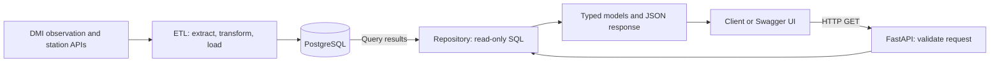

# DMI REST API user guide

The API exposes DMI observations imported into PostgreSQL by the ETL pipeline.
It uses FastAPI and returns JSON over HTTP. Clients can read measurements,
station metadata, and parameter definitions through the endpoints below.

## Contents

1. [Run the API locally](#run-the-api-locally)
2. [Discover the available data](#discover-the-available-data)
3. [Filter and paginate measurements](#filter-and-paginate-measurements)
4. [Make an API request](#make-an-api-request)
5. [Understand error responses](#understand-error-responses)
6. [Follow the implementation](#follow-the-implementation)
7. [Check code quality and run tests](#check-code-quality-and-run-tests)
8. [Local acceptance check](#local-acceptance-check)
9. [Refresh data and prepare for deployment](#refresh-data-and-prepare-for-deployment)

## Run the API locally

Start Docker Desktop with Docker Compose available, then open a terminal in
this project's root directory. If you do not already have a local configuration,
copy the committed example:

```powershell
Copy-Item .env.example .env
```

Keep `POSTGRES_HOST=db` and `POSTGRES_PORT=5432` when using Docker Compose.
The API reads the same five `POSTGRES_*` variables as the ETL application:
host, port, database name, username, and password. See
[the environment example](../.env.example) for their exact names.

Import DMI observations using the standard application command:

```powershell
docker compose up --build app
```

Wait for the ETL completion message. If Compose remains attached after
`app_service` exits, press Ctrl+C to finish that command. Then start the API
in the background:

```powershell
docker compose up --build -d api
```

If the database already contains imported data, only the API command is
needed. Both services start PostgreSQL automatically when required. The API
applies pending database migrations during startup. An empty database returns
empty data lists until the ETL application imports observations.

The ETL command uses the Compose service name `app`; `app_service` is its
container name. `docker compose run --build --rm app` is also valid: it runs
the same ETL code in a temporary container and removes that container when
finished. The API uses `up` so Docker publishes its configured port.

The API requires database configuration only. The ETL application additionally
uses `DMI_API_URL` and the optional `DMI_PARAMETER_IDS` selection. HTTP requests
to this API read stored observations and do not trigger requests to DMI.

| Address | Purpose |
| --- | --- |
| <http://localhost:8000/docs> | Interactive Swagger documentation with **Try it out** |
| <http://localhost:8000/redoc> | Alternative documentation view |
| <http://localhost:8000/openapi.json> | OpenAPI specification for clients and tools |
| <http://localhost:8000/health> | API and database connectivity check |

The Docker port is bound to `127.0.0.1:8000` on your computer. Uvicorn's
`--host 0.0.0.0` setting applies inside the container so Docker can forward
local requests to it. The supplied configuration makes the API available
locally.

View logs with `docker compose logs api`. Stop the API with
`docker compose stop api`, or stop the project's services with
`docker compose down`. The latter preserves the PostgreSQL data volume.

## Discover the available data

Data endpoints use the versioned `/api/v1` prefix. All endpoints use HTTP GET.

| Path | Response |
| --- | --- |
| `/health` | `{"status":"ok"}` when PostgreSQL can execute a query |
| `/api/v1/parameters` | Parameter IDs, names, and units with imported DMI measurements |
| `/api/v1/stations` | Paginated station metadata, ordered by station ID |
| `/api/v1/stations/{station_id}` | One station's latest imported metadata and coordinates |
| `/api/v1/measurements` | Paginated DMI measurements, newest first |
| `/api/v1/measurements/{measurement_id}` | One DMI measurement, including its parameter name and unit |

A station ID is a string, such as `06180`. Preserve its leading zeros. The
station list can include stations without measurements for the parameters or
time interval you have imported. Coordinates use WGS84; station height is in
metres and may be `null`.

The parameter list includes only types with stored DMI observations. The API
uses numeric database IDs: `1` represents temperature and `2` represents
humidity. DMI's text identifier `temp_dry` is used during extraction and is
not accepted as the API's `parameter_id`. The complete internal ID catalogue
is defined in [the parameter enum](../app/constants/parameters.py).

The original database catalogue also contains CO2 and PM2.5. Those types only
appear in this API's parameter list if DMI measurements exist for them; the
current ETL application does not import them.

## Filter and paginate measurements

`GET /api/v1/measurements` accepts the following optional query parameters.
Every supplied filter must match for an observation to be included.

| Parameter | Type | Meaning |
| --- | --- | --- |
| `station_id` | String, 1–50 characters | Include only this station's measurements |
| `parameter_id` | Integer ≥ 1 | Include only this measurement type; discover IDs through `/api/v1/parameters` |
| `start` | ISO 8601 timestamp with timezone | Earliest observation time, inclusive |
| `end` | ISO 8601 timestamp with timezone | Latest observation time, inclusive |
| `limit` | Integer from 1 to 1000 | Maximum items per page; default `100` |
| `offset` | Integer ≥ 0 | Matching items to skip; default `0` |

Both timestamps must include a timezone, for example
`2026-10-26T10:00:00Z` for UTC. Timestamps without a timezone are rejected.
`start` must be earlier than or equal to `end`. Encode a literal `+` as `%2B`
when using a timezone such as `+01:00` in a URL. Python's `requests` handles
this encoding when parameters are supplied through `params`.

Without time filters, the API searches all stored observations. The station
list also supports `limit` and `offset`.

Both paginated endpoints return `items`, `limit`, `offset`, and `has_more`.
When `has_more` is `true`, request the next page with `offset + limit` and
unchanged filters. Measurements sharing a timestamp are ordered by descending
`measurement_id` to make ordering deterministic.

Pages reflect the database at the time of each request. Imports between
requests can change page positions. A fixed `end` bounds the time interval;
it does not create a snapshot or prevent changes from backfilled observations.

## Make an API request

First discover the imported measurement types:

```powershell
Invoke-RestMethod -Uri 'http://localhost:8000/api/v1/parameters'
```

Then fetch the two newest stored temperature observations:

```powershell
curl.exe "http://localhost:8000/api/v1/measurements?parameter_id=1&limit=2"
```

On Linux or macOS, use `curl` instead of `curl.exe`. An illustrative response
from a database containing these observations is:

```json
{
  "items": [
    {
      "measurement_id": 42,
      "source_id": "DMI",
      "station_id": "06180",
      "parameter_id": 1,
      "parameter_name": "Temperature",
      "unit": "°C",
      "timestamp": "2026-10-26T10:00:00Z",
      "value": 12.3
    },
    {
      "measurement_id": 41,
      "source_id": "DMI",
      "station_id": "06030",
      "parameter_id": 1,
      "parameter_name": "Temperature",
      "unit": "°C",
      "timestamp": "2026-10-26T10:00:00Z",
      "value": 10.5
    }
  ],
  "limit": 2,
  "offset": 0,
  "has_more": true
}
```

Actual values and IDs depend on your ETL runs. `timestamp` is the observation
time with a timezone. `value` is a JSON number expressed in `unit`. The unit
`enum` identifies a categorical DMI code, such as a weather code. These codes
are returned as numbers and are not translated to text.

To filter by station and time interval in PowerShell:

```powershell
$uri = 'http://localhost:8000/api/v1/measurements' +
    '?station_id=06180&parameter_id=1' +
    '&start=2026-10-26T00:00:00Z&end=2026-10-26T23:59:59Z&limit=10'
Invoke-RestMethod -Uri $uri
```

Choose a station from `/api/v1/stations` and dates from your stored
observations if the example's station or interval is unavailable.

The same API can be called from Python using the project's `requests` package:

```python
import requests

response = requests.get(
    "http://localhost:8000/api/v1/measurements",
    params={"parameter_id": 1, "limit": 2},
    timeout=10,
)
response.raise_for_status()
for measurement in response.json()["items"]:
    print(measurement["station_id"], measurement["value"], measurement["unit"])
```

## Understand error responses

| HTTP status | Meaning |
| --- | --- |
| `200 OK` | Request succeeded; an empty search returns `items: []` and `has_more: false` |
| `404 Not Found` | The requested station or DMI measurement ID does not exist |
| `422 Unprocessable Entity` | Invalid filters, timestamps, or pagination values |
| `503 Service Unavailable` | The API cannot connect to or query PostgreSQL |

For example, `GET /api/v1/stations/unknown` returns HTTP 404 with:

```json
{"detail": "Station not found."}
```

Field validation errors contain a `detail` list describing the invalid input.
A reversed time interval returns a `detail` string:
`start must be before or equal to end.` Database errors return a generic
message so SQL, credentials, and connection settings are not exposed.

## Follow the implementation

The application has two independently started services: ETL imports data,
and the API serves the stored results. They share the PostgreSQL database.



### 1. Import and store observations

[The ETL entry point](../app/main.py) reads the configuration and applies
versioned SQL migrations. [The pipeline](../app/pipeline.py) fetches DMI
station metadata and the selected observation types, transforms the records
into the project's DTOs, and persists them through
[the write repository](../app/load/measurement_repository.py).

Source metadata, stations, and measurements are saved in one transaction.
Each measurement references a source, station, and parameter. Repeated imports
update matching observations without creating duplicate measurement keys.
The [README architecture section](../README.md#architecture) explains the
existing ETL components and database schema in detail.

### 2. Start the API and prepare the database

[The API entry point](../app/api/main.py) creates the FastAPI application,
registers the versioned routes, and supplies a lifecycle function named
`lifespan`. FastAPI runs this function before accepting requests. It applies
pending migrations without starting ETL or requesting new data from DMI.

### 3. Validate the request and open a connection

FastAPI reads the route's type hints and `Annotated` constraints to validate
query and path parameters. Limits, IDs, and timezone-aware timestamps are
checked before the route executes. The measurements route additionally
rejects `start > end` before querying observations.

The `get_repository` dependency opens one PostgreSQL connection and marks its
transaction read-only. FastAPI supplies this repository to the route. The
connection context closes the connection when the dependency finishes,
including when a request fails. Dependencies can be resolved before field
validation finishes, so an invalid request may still open a connection.

### 4. Execute a bounded, parameterized query

[The API read repository](../app/api/repository.py) owns the SELECT statements.
Its measurement queries restrict results to `source_id = 'DMI'` and join the
parameter table to include names and units. Filter clauses are fixed SQL;
client values are supplied separately as bound parameters.

List routes request `limit + 1` rows. The extra row indicates whether another
page exists, avoiding a separate count of all matching observations.

### 5. Validate database rows and construct the response

[The public models](../app/api/models.py) define `Parameter`, `Station`,
`Measurement`, and the generic `Page[ItemT]` response. The repository validates
database rows into the appropriate models. A shared `AwareTimestamp` type
combines Python's `datetime` type with Pydantic's timezone requirement.

The route builds a typed page, removes the lookahead row, and sets `has_more`.
FastAPI validates and serializes the public response model to JSON. These
same schemas and route docstrings populate Swagger UI and OpenAPI.

### 6. Trace a complete example

For `GET /api/v1/measurements?parameter_id=1&limit=2`:

1. FastAPI parses `parameter_id` and `limit` as integers and checks their bounds.
2. The connection dependency provides a read-only repository.
3. The route requests up to three DMI temperature observations from the repository.
4. PostgreSQL orders matches by descending observation time and measurement ID.
5. The repository converts the rows into `Measurement` models.
6. The route returns at most two items and sets `has_more` from the third row.
7. FastAPI serializes the `Page[Measurement]` response and closes the connection.

Missing detail resources become HTTP 404. Database exceptions are translated
to HTTP 503 by the shared handler. Invalid inputs use HTTP 422. These responses
are documented in OpenAPI along with the successful response schemas.

## Check code quality and run tests

The API code includes module, class, and function docstrings in English.
Function signatures specify argument and return types, including model types,
optional results, generic pages, and generator-based dependencies.

Ruff checks PEP 8 conventions, import order, and modern Python syntax. The API
and its tests use 79-character code lines and wrapped docstrings.
The existing project configuration retains its 88-character maximum for
older modules. Type annotations also drive FastAPI validation; they do not
replace linting or automated tests.

Run the project lint checks and the stricter API checks from the project root:

```powershell
python -m ruff check app tests
python -m ruff check app/api --select E,F,I,UP,D,ANN --ignore ANN401 --line-length 79
python -m ruff format --check --line-length 79 app/api tests/unit/test_api.py tests/unit/test_api_repository.py tests/integration/test_rest_api.py
```

These local commands require the development dependencies from
[requirements-dev.txt](../requirements-dev.txt). Alternatively, run the same
commands with `docker compose run --build --rm tests` before `python`.

Run the unit tests and API integration tests with coverage:

```powershell
docker compose run --build --rm tests pytest tests/unit tests/integration/test_rest_api.py --cov=app --cov-report=term-missing --cov-fail-under=95
```

The API tests cover request validation, documentation, numeric serialization,
pagination, missing resources, and database failures. Repository unit tests
check SQL parameter binding, DMI source filtering, and typed results. The API
integration tests run real SQL against temporary tables on a dedicated
PostgreSQL connection. They leave stored DMI observations untouched and do
not require network access to DMI.

Run the full suite, including the existing DMI connectivity test, with:

```powershell
docker compose run --build --rm tests
```

## Local acceptance check

After completing the local setup and importing DMI data, use Swagger UI at
<http://localhost:8000/docs> to perform these checks. Select station IDs,
parameter IDs, and timestamps from returned measurements when testing filters.

| Check | Expected result |
| --- | --- |
| Open `/docs` | Endpoints, parameters, and response schemas are available. |
| Request `/health` | HTTP 200 with `{"status":"ok"}`. |
| Request `/api/v1/measurements?limit=2` | HTTP 200 with stored measurements, including station ID, timestamp, value, and unit; at most two items. |
| Filter measurements by station, parameter, and time interval | Every returned item matches all filters, including the time boundaries. |
| Follow a page with `has_more: true` | Increasing `offset` by `limit` returns the next page with unchanged filters. Run this check without another ETL import between requests. |
| Request `/api/v1/measurements?limit=0` | HTTP 422 describing the invalid input. |
| Request `/api/v1/stations/unknown` | HTTP 404. |
| Request `/api/v1/measurements?station_id=unknown` | HTTP 200 with `items: []` and `has_more: false`. |

Record each check as passed or failed. Save one successful measurement request
and its actual JSON response as the demonstration example, together with the
test date. If no measurements are returned, verify that the ETL import
completed and that the selected filters match stored data before accepting
the result.

## Refresh data and prepare for deployment

The API serves stored data and does not refresh it automatically. Start another
ETL run with `docker compose up --build app`. For a refresh while the API is
already running, `docker compose run --build --rm app` runs ETL in a temporary
container and leaves the API and database services running when it finishes.
API requests can read newly committed data without restarting the API. If
you use the attached `up` command, pressing Ctrl+C can also stop its database
dependency. By default, ETL imports temperature and humidity from the previous
24 hours; older imported
observations remain in the database.

API and ETL are separate services with a shared database. A later deployment
can use the same Uvicorn entry point and database configuration. The current
application has no authentication. Public access, HTTPS, access control, and
operational configuration belong to the later deployment task.
